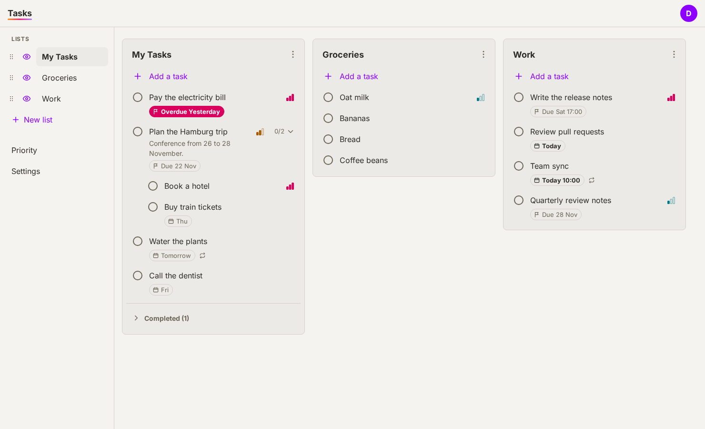
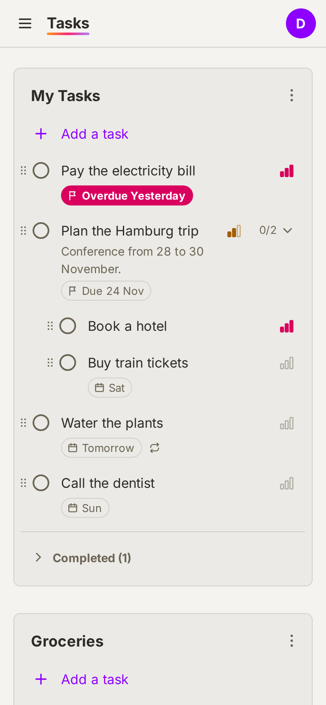
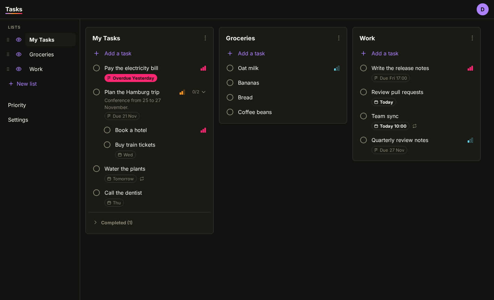
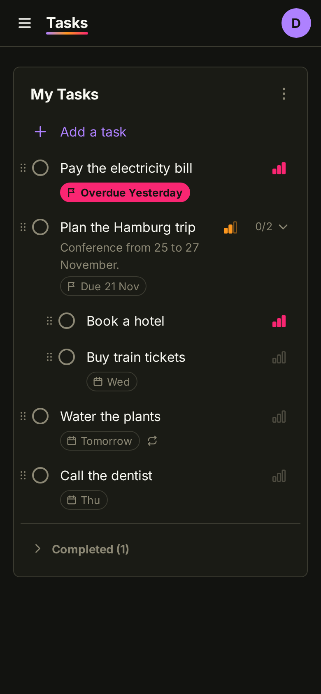

# Tasks

A minimalist, self-hosted to-do app in the spirit of Google Tasks. Each User keeps private Lists of Tasks, signs in through an OIDC provider, and can subscribe to their dated Tasks from an external calendar. See [`CONTEXT.md`](CONTEXT.md) for the domain language and [`docs/adr/`](docs/adr/) for the architectural decisions.

Built with SvelteKit (Svelte 5, TypeScript) on the Node adapter, with SQLite through Drizzle ORM.

## Screenshots

|       | Desktop                                                     | Mobile                                                                              |
| ----- | ----------------------------------------------------------- | ----------------------------------------------------------------------------------- |
| Light |  |  |
| Dark  |    |    |

Retake them with `npm run screenshots` after a visible change. It builds the app, signs in through the e2e mock provider, fills in sample data and overwrites `docs/screenshots/`.

## Local development

Requires Node 26 and npm.

```sh
npm install
cp .env.example .env
npm run oidc:mock   # in a second terminal
npm run dev
```

The dev server runs on <http://localhost:5173>. The SQLite database is created at `./data/tasks.db` on first start and migrated automatically.

Login is OIDC only, so the server needs a provider even in development. `npm run oidc:mock` starts the same mock provider the e2e tests use on port 4185; it signs you in as "Dev User" without asking anything. `.env.example` points the app at it. To use a real provider instead, put its settings in `.env` (see [Configuration](#configuration)).

To run the end-to-end tests you need a Playwright browser once:

```sh
npx playwright install chromium
```

E2E tests sign in through the mock provider with `loginAs(page, { sub, name, email, groups })` from `e2e/auth.ts` (every field optional; `sub` defaults to a fresh random User). The e2e server runs with `OIDC_ALLOWED_GROUP=tasks-users`, and `loginAs` puts Users in that group unless you pass `groups`. `logout(page)` signs out.

### Scripts

| Script                 | What it does                                                                                                                                           |
| ---------------------- | ------------------------------------------------------------------------------------------------------------------------------------------------------ |
| `npm run dev`          | Start the Vite dev server.                                                                                                                             |
| `npm run build`        | Build the production server into `build/`.                                                                                                             |
| `npm start`            | Run the production build (`node build`).                                                                                                               |
| `npm test`             | Run the unit tests (Vitest) once. `npm run test:watch` keeps them running.                                                                             |
| `npm run test:e2e`     | Build the app, start it on port 4173 (`E2E_PORT`) with a throwaway database and the mock OIDC provider on port 4185 (`E2E_OIDC_PORT`), run Playwright. |
| `npm run oidc:mock`    | Start the mock OIDC provider for local development.                                                                                                    |
| `npm run lint`         | Check formatting (Prettier) and lint (ESLint).                                                                                                         |
| `npm run format`       | Format everything with Prettier.                                                                                                                       |
| `npm run check`        | Compile the messages (`npm run i18n:compile`), then type-check with `svelte-check`.                                                                    |
| `npm run i18n:compile` | Compile `messages/` into `src/lib/paraglide/`. Dev, build and tests do it themselves, through the Vite plugin.                                         |
| `npm run db:generate`  | Generate a new migration in `drizzle/` from `src/lib/server/db/schema.ts`.                                                                             |
| `npm run db:studio`    | Open Drizzle Studio against the local database.                                                                                                        |

### Data access: always scope by User

Nothing is shared between Users, so **every query against User-owned data must be filtered by the signed-in User's id**. The `handle` hook keeps anonymous requests away from every route except `/auth/*`, `/healthz` and `/cal/*`, and puts the User in `locals.user`; data access builds on that:

```ts
import { requireUser, userScope, ownedBy } from '#lib/server/scope.js';

export const load: PageServerLoad = ({ locals }) => {
	const scope = userScope(locals); // 401 if nobody is signed in
	return { lists: scope.db.select().from(lists).where(ownedBy(lists.userId, scope)).all() };
};
```

Data-access functions take a `UserScope` (never a bare `Db`) and filter by `scope.userId`, including in `update` and `delete` statements, so a guessed id from another User matches nothing. `requireUser(locals)` returns the `User` when you only need who is signed in. Pages get the User as `data.user` (`{ id, name, email }` or `null`) from the root layout.

### Reading and changing data

Pages load their data in `load` functions; changes go through the JSON endpoints under `src/routes/api/`, called via `api` in `src/lib/client/api.ts` (see [ADR 0003](docs/adr/0003-json-endpoints-for-mutations.md)). Components don't call `api` directly: they use the page's `TaskStore` and the layout's `ListStore` (`getTaskStore()` / `getListStore()`), which update the screen optimistically. The open Task detail panel is part of the URL (`?task=<id>`), so `/lists/<listId>?task=<taskId>` links straight to a Task. `/` shows the User's visible Lists as columns (one List at a time below 768px, picked in the menu: the List last viewed on this device); `/lists/<listId>` is the same view focused on that List, even if it is hidden. Lists are shown, hidden and reordered in the sidebar (`PATCH /api/lists/[id]` with `visible`, or `before`/`after` another List's id). Tasks are rearranged in Custom Order by dragging their handle (or Arrow keys on the focused handle), and moved between Lists by dragging across columns or with "List" in the detail panel; all of it goes through `POST /api/tasks/[id]/move` with `{ listId, parentId, before?, after? }`, whose rules live in `src/lib/domain/moves.ts`. Drag-and-drop is offered only while a List's Sort Mode is Custom Order. Completing a Task, deleting one, and moving one to another List show a toast with Undo (also Ctrl/Cmd+Z outside text fields) that restores the exact previous state: Undo complete, Undo move (to another List) and Undo delete (of a Subtask, a Task, or a skipped Occurrence) send the `undo` from the `POST /api/tasks/[id]/complete`, `POST /api/tasks/[id]/move` or `DELETE /api/tasks/[id]` answer to `POST /api/undo` (see [ADR 0004](docs/adr/0004-undo-with-before-state-on-the-server.md)); Reopen from the Completed section is not an Undo.

### Translations

The UI speaks English and German (`CONTEXT.md` → Language, [ADR 0005](docs/adr/0005-language-is-a-user-preference-not-a-url.md)). Messages live in one file per Language, `messages/en.json` (English, the source) and `messages/de.json`; `project.inlang/settings.json` lists the Languages, so a third one is one more file and one entry there. [Paraglide JS](https://paraglidejs.com) compiles them into typed functions in `src/lib/paraglide/`, which is not committed and is regenerated by every build, `npm test` and `npm run check`.

**Adding a message**: add the key to every file in `messages/`, keeping the keys sorted, then use it:

```svelte
<script lang="ts">
	import { m } from '#lib/paraglide/messages.js';
</script>

<button aria-label={m.shell_sidebar_show_list({ name: list.name })}>{m.shell_sign_out()}</button>
```

Keys are `snake_case` and start with their area's prefix, so branches working on different areas rarely touch the same lines: `shell_` (app shell, sidebar, user menu, theme), `auth_` (login, not allowed), `error_page_`, `settings_`, `list_`, `task_`, `subtask_`, `priority_`, `sort_`, `toast_`, `confirm_`, `api_error_`, `date_`, `recurrence_`, `scope_` (the Occurrence scope dialog), `feed_` (Calendar Link events), `default_list_`. A new area adds its prefix to `KEY_PREFIXES` in `src/lib/translations.spec.ts`. That test (part of `npm test`, so CI) fails when a message is missing in some Language or exists only there, is empty, uses other `{placeholders}` than English, or when keys are unsorted or unprefixed. Paraglide itself would silently fall back to English.

Placeholders are `{name}`. Counts use plural rules, never string concatenation:

```json
"task_completed_count": [
	{
		"declarations": ["input count", "local countPlural = count: plural"],
		"selectors": ["countPlural"],
		"match": { "countPlural=one": "{count} erledigte Aufgabe", "countPlural=*": "{count} erledigte Aufgaben" }
	}
]
```

**German style**: address the User with "du", or better, phrase things impersonally ("Liste hinzufügen"). Use the glossary's terms: List = Liste, Task = Aufgabe, Subtask = Unteraufgabe, Planned Date = Geplant, Due Date = Fällig, Duration = Dauer, Priority = Priorität (Hoch/Mittel/Niedrig), Completed = Erledigt, Reopen = Wieder öffnen, Undo = Rückgängig, Recurrence = Wiederholung, Occurrence = Termin, Custom Order = Eigene Reihenfolge, Sort Mode = Sortierung, Calendar Link = Kalender-Link. The app is called Tasks in every Language, so "Tasks" stays out of the messages (`<title>{m.auth_sign_in()} · Tasks</title>`). What Users create, like List names, is never translated.

**Which Language**: the `handle` hook from `createLanguageHandle` (`src/lib/server/language.ts`, after the auth hook) resolves it once per request with `resolveLanguage`: the User's stored choice if there is one (`user_preferences.language_preference`, `'automatic'` by default; read together with the session lookup into `locals.languagePreference`, so it costs no extra query; chosen in Settings through `PUT /api/language-preference`, which the page follows with a full reload), otherwise the first Language we speak in `Accept-Language` by preference, otherwise English. During the request `m.*()` and Paraglide's `getLocale()` use it, `<html lang>` says it, and it is in `locals.language` and, for pages, `data.language`. The browser reads it back from `<html lang>` (`src/hooks.client.ts`) and keeps it for the whole document, so switching Language takes a full page load. Dates and times are formatted with `locals.dateLocale` / `data.dateLocale`, not the Language: the browser's own tag (`de-AT`, `en-GB`) under Automatic, the bare Language (`de`) when chosen. Calendar Links (`/cal/…`) skip all this: a calendar app's `Accept-Language` says nothing about the owner, so they are English unless the feed passes a Language itself. To speak a given Language whatever the request (e.g. a Calendar Link's owner's), pass it to the message, `m.feed_due({ title }, { locale: 'de' })`, or wrap the code in `withLanguage('de', () => …)` on the server.

**Server errors**: the few errors a User can run into through the UI (a Task deleted in another tab, clearing the last date of a repeating Task, a refused Undo, a parent completed elsewhere) carry a stable code next to the English `message`: `error(404, { message, code })`, with `code` typed by `App.Error`. The codes are listed in `src/lib/domain/error-codes.ts`, and `src/lib/client/api-errors.ts` maps each to an `api_error_` message; `ApiError.message` is that translation, so toasts and the settings form show it. A code the browser doesn't know gets `api_error_unknown`, and an answer without a code (what only a hand-made request causes: wrong content type, malformed JSON, wrong field types) keeps the server's English text. A new reachable error needs a code in the list, a message and `InvalidInputError(message, code)` / `notFound(what, code)` / `error(status, { message, code })` where it is thrown.

E2E tests run in English (`locale: 'en-US'` in `playwright.config.ts`); a test in German says `test.use({ locale: 'de-DE' })`, and `loginAs` works in both.

### Database migrations

The schema lives in `src/lib/server/db/schema.ts`. After changing it, run `npm run db:generate` and commit the generated files in `drizzle/`. The server applies pending migrations when it starts (from the `init` hook in `src/hooks.server.ts`), so there is no separate migrate step. Migrations are read from `./drizzle` relative to the working directory, so start the server from the project root.

## Running with Docker

Images for `linux/amd64` and `linux/arm64` are published to the GitHub Container Registry: `ghcr.io/marcusleg/tasks:main` follows the `main` branch, `:sha-<short>` pins a commit, and releases are tagged `:<version>` (for example `:0.1.0`) and `:latest`.

```sh
docker run -d --name tasks \
  -p 3000:3000 \
  -v tasks-data:/data \
  ghcr.io/marcusleg/tasks:latest
```

Or with Docker Compose:

```yaml
services:
  tasks:
    image: ghcr.io/marcusleg/tasks:latest
    restart: unless-stopped
    ports:
      - '3000:3000'
    volumes:
      - tasks-data:/data
    environment:
      DATABASE_PATH: /data/tasks.db
      PORT: 3000
      # Behind a TLS-terminating reverse proxy, see Environment variables below:
      # PROTOCOL_HEADER: x-forwarded-proto
      # HOST_HEADER: x-forwarded-host
      # OIDC settings: see Configuration.

volumes:
  tasks-data:
```

Data lives in the `/data` volume. See [Running the container](#running-the-container) for building the image yourself and for bind-mount permissions.

## Running the container

```sh
docker build -t tasks .
docker run -p 3000:3000 -v tasks-data:/data \
  -e ORIGIN=https://tasks.example.com \
  -e OIDC_ISSUER=https://id.example.com \
  -e OIDC_CLIENT_ID=... -e OIDC_CLIENT_SECRET=... \
  tasks
```

The image runs as the unprivileged `node` user (uid 1000), listens on port 3000 and keeps its database in the `/data` volume. If you bind-mount a host directory instead of a named volume, it must be writable by uid 1000. `GET /healthz` returns `{"status":"ok"}` with status 200 when the server is up and the database is reachable, and 503 otherwise. See [Configuration](#configuration) for the environment variables.

## Configuration

The app is configured with environment variables. It refuses to start if a required one is missing.

| Variable             | Required | Purpose                                                                                                                                                                                        |
| -------------------- | -------- | ---------------------------------------------------------------------------------------------------------------------------------------------------------------------------------------------- |
| `ORIGIN`             | yes      | Public URL of the app, scheme and host only, e.g. `https://tasks.example.com`. The OIDC redirect URL is `${ORIGIN}/auth/callback`. Cookies are marked `Secure` when it starts with `https://`. |
| `OIDC_ISSUER`        | yes      | Issuer URL of the OIDC provider, e.g. `https://id.example.com`. The discovery document is read from `${OIDC_ISSUER}/.well-known/openid-configuration`.                                         |
| `OIDC_CLIENT_ID`     | yes      | Client ID of this app at the provider.                                                                                                                                                         |
| `OIDC_CLIENT_SECRET` | yes      | Client secret of this app at the provider.                                                                                                                                                     |
| `OIDC_ALLOWED_GROUP` | no       | If set, only Users whose `groups` claim contains exactly this value may sign in. Everyone else sees a "not allowed" page and no account is created for them.                                   |
| `DATABASE_PATH`      | no       | Path to the SQLite database file. Defaults to `./data/tasks.db` in dev and `/data/tasks.db` in production. Its directory is created if missing.                                                |
| `PORT`               | no       | Port the production server listens on (adapter-node, default `3000`).                                                                                                                          |
| `PROTOCOL_HEADER`    | no       | Header carrying the original protocol from the reverse proxy, usually `x-forwarded-proto`. See below.                                                                                          |
| `HOST_HEADER`        | no       | Header carrying the original host from the reverse proxy, usually `x-forwarded-host`. See below.                                                                                               |

The other adapter-node variables (`HOST`, `BODY_SIZE_LIMIT`, `SHUTDOWN_TIMEOUT`, …) are documented in the [adapter-node docs](https://svelte.dev/docs/kit/adapter-node).

### Signing in

Login uses the OIDC Authorization Code flow with PKCE (S256), `state` and `nonce`, as a confidential client. The client authenticates at the token endpoint with `client_secret_basic`, or `client_secret_post` if that's all the provider offers. The app requests the scopes `openid profile email`, plus `groups` when the provider lists it in `scopes_supported` (or, if it lists no scopes, when `OIDC_ALLOWED_GROUP` is set). Groups are read from the ID token, falling back to the userinfo endpoint.

A User is identified by the issuer plus the `sub` claim. Their display name and email are refreshed from the claims on every login. Sessions last 30 days and are extended to 30 days again once less than 15 remain. Logging out ends only the session in that browser, not the one at the provider.

### Pocket ID

1. In Pocket ID, go to **Administration → OIDC Clients** and add a client named e.g. "Tasks".
2. Add the callback URL `https://<your tasks host>/auth/callback` (exactly `${ORIGIN}/auth/callback`).
3. Leave it a confidential client (not "Public client") and turn on **PKCE**: the app always sends a PKCE challenge, and enabling it makes Pocket ID insist on one.
4. Save, then copy the client ID and the client secret (the secret is shown only once).
5. Configure the app:

   ```sh
   ORIGIN=https://tasks.example.com
   OIDC_ISSUER=https://id.example.com      # Pocket ID's APP_URL, no trailing slash
   OIDC_CLIENT_ID=<client id>
   OIDC_CLIENT_SECRET=<client secret>
   ```

6. Optional group restriction: create a user group in Pocket ID and add the Users who may use Tasks. Then either set `OIDC_ALLOWED_GROUP` to the group's **name** (not its friendly name; Pocket ID puts names into the `groups` claim), or select the group under **Allowed user groups** on the OIDC client, which makes Pocket ID itself refuse everyone else. Doing both is fine.

### Reverse proxy

Run the app behind a TLS-terminating reverse proxy (Caddy, nginx, Traefik, …) and set `ORIGIN` to the public `https://` URL.

SvelteKit 3's Node adapter doesn't read `ORIGIN`. It derives each request's origin from headers: the protocol from `PROTOCOL_HEADER` (and **assumes `https` if that's unset or the header is missing**), the host from `HOST_HEADER`, falling back to `Host`. SvelteKit compares that origin to the browser's `Origin` header to reject cross-site form posts (its CSRF protection, which covers the logout endpoint and all form actions), and redirects build on it. So the derived origin must equal `ORIGIN`:

- If the proxy passes the original `Host` header through (Caddy does by default; with nginx use `proxy_set_header Host $host;`) and the public URL is https, nothing else is needed.
- Otherwise have the proxy send `X-Forwarded-Proto`/`X-Forwarded-Host` and set `PROTOCOL_HEADER=x-forwarded-proto` and `HOST_HEADER=x-forwarded-host`. Only do this when the app is reachable solely through the proxy, since clients could otherwise send those headers themselves.
- Serving the app over plain `http` (no TLS) needs `PROTOCOL_HEADER=x-forwarded-proto` and a proxy that sends `X-Forwarded-Proto: http`; without it every form post fails with "Cross-site POST form submissions are forbidden".

If the two disagree, form posts are rejected with 403, so a misconfiguration fails closed. The OIDC redirect URL and the cookies' `Secure` flag always come from `ORIGIN`, not from request headers.
